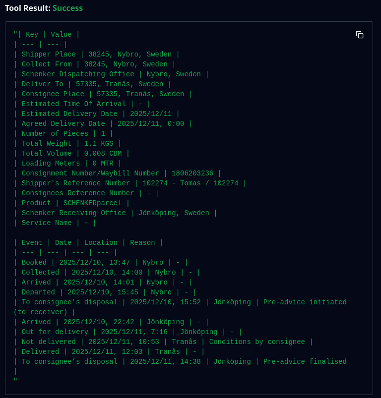

# DB Schenker Shipment MCP Server

An MCP (Model Context Protocol) server that lets an AI assistant, such as Claude, look up DB Schenker shipments.
You give it a tracking number and it returns the shipment details and tracking history as markdown tables.

> **Note:** This project was built for DB Schenker's public tracking website (December 2025 to February 2026).
> DB Schenker is now part of DSV, and the old tracking page redirects to a DSV page with a different layout.
> Live lookups will therefore most likely return "No shipment found". The parsing code is still covered by
> tests that use small HTML pages built to match the old DB Schenker layout.



## How it works

The server has one tool, `track_shipment(tracking_number)`.

1. It checks that the tracking number is valid (10 digits, starting with `180`).
2. It opens the public DB Schenker tracking page in a headless Chromium browser with Playwright.
   The page is built with JavaScript, so a real browser is needed.
3. It clicks "See more" to show the full history.
4. It reads the page with BeautifulSoup and turns the details and history into markdown tables.

If the number is invalid, the page cannot be loaded, or no shipment is found, the tool returns a short error message that tells the assistant what went wrong.

## Project layout

| File | Purpose |
| --- | --- |
| `server.py` | The MCP server and the `track_shipment` tool |
| `schenker.py` | Loads the page with Playwright and parses it into markdown |
| `tests/` | Tests for the parser and the server, using saved HTML files |
| `run.sh` | Installs everything and opens the server in MCP Inspector |

## Requirements

- Linux. It has only been tested on Linux, and `run.sh` is a bash script.
- Python 3.13 or newer
- [uv](https://docs.astral.sh/uv/)
- Node.js (only needed for MCP Inspector)

Install uv:

```sh
curl -LsSf https://astral.sh/uv/install.sh | sh
```

## Setup

```sh
git clone https://github.com/douglasf01/DB-Schenker-Shipment-MCP-Server
cd DB-Schenker-Shipment-MCP-Server
uv sync
uv run playwright install chromium
```

`uv sync` creates a `.venv` folder and installs the Python packages.
The second command downloads the Chromium browser that Playwright uses.

## Use it with Claude

### Claude Code

Run this inside the project folder:

```sh
claude mcp add schenker -- uv --directory "$(pwd)" run server.py
```

### Claude Desktop

Add this to your `claude_desktop_config.json` and change the path to where you cloned the project:

```json
{
  "mcpServers": {
    "schenker": {
      "command": "uv",
      "args": ["--directory", "/path/to/DB-Schenker-Shipment-MCP-Server", "run", "server.py"]
    }
  }
}
```

Restart Claude Desktop. Then ask something like "Where is my DB Schenker shipment 1806203236?".

## Test it with MCP Inspector

MCP Inspector is a web page for trying out MCP servers by hand. Start it with:

```sh
./run.sh
```

The script installs the dependencies and Chromium, then opens MCP Inspector at `http://localhost:6274`.

1. Press **Connect**.
2. Open the **Tools** tab and press **List Tools**.
3. Select **track_shipment**, enter a tracking number and press **Run Tool**.

## Run the tests

```sh
uv run pytest
```

The tests do not use the network. They use small saved HTML files in `tests/fixtures/` to check the parser, and an in-memory MCP client to check the tool and its error messages.
